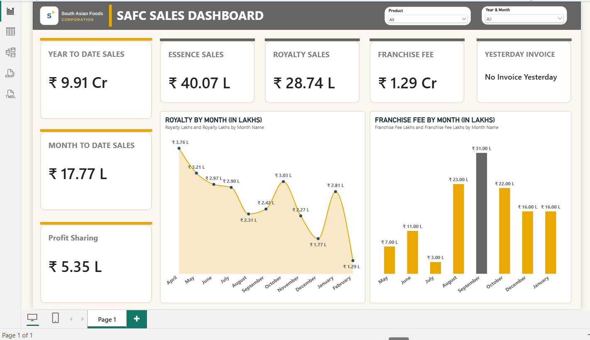

# SAFC Sales Dashboard – Franchise Income Tracker

A Power BI dashboard built for and used at **South Asian Foods Corporation Pvt. Ltd. (Mr. Goli Soda), Chennai**, to track income from the franchise network – Essence sales, Royalty, Franchise Fee and Profit Sharing – along with yesterday's, month-to-date and year-to-date sales.

> **Note:** This is a real, in-use company dashboard. The Power BI (.pbix) file and the source data are **not included** in this repository because they contain confidential company and customer information. Only a screenshot of the dashboard is shared.

<!-- Upload your screenshot to this repository and name it dashboard.png -->

## Business problem
Sales and franchise income were reported from raw invoice exports in Excel. Management could not quickly see how much each income stream (Essence, Royalty, Franchise Fee, Profit Sharing) was contributing, how the current month was tracking, or which months performed best across the financial year.

## Who uses it
- **Management** – overall sales position: yesterday, month to date and year to date
- **Finance team** – income by stream and month-wise trends
- **Franchise team** – royalty and franchise fee collection by month

## What the dashboard shows
**KPI cards**
- Year to Date Sales (financial year, April – March)
- Month to Date Sales
- Yesterday's Invoice Value (shows "No Invoice Yesterday" when there were no sales)
- Essence Sales
- Royalty Sale
- Franchise Fee
- Profit Sharing Value

**Charts**
- **Royalty by Month** – line chart showing the month-wise royalty trend
- **Franchise Fee by Month** – column chart, with the highest month automatically highlighted

**Filters**
- Product
- Year & Month

## Key features
- **Financial-year month order** – charts run April → March instead of January → December, using a custom sort column
- **Indian number format** – KPI values shown in ₹ Crore (Cr), Lakh (L) and Thousand (K)
- **Automatic peak highlight** – the best month in the Franchise Fee column chart is shown in a different colour and updates with the filters
- **Product-specific KPIs** – each income card always shows its own product, even when the Product filter is used
- **Clean, consistent design** – custom Power BI theme (charcoal and gold) with rounded cards and filters

## How the data flows
1. Invoice data is exported to Excel.
2. Power BI is connected directly to the Excel file.
3. On refresh, all KPIs and charts update with the latest invoices.

## My role
- Understood the reporting needs of management and the finance team
- Cleaned and structured the invoice data
- Wrote DAX measures for YTD, MTD, yesterday's sales and each income stream
- Built number-format measures for ₹ Cr / L / K display
- Created a financial-year month sort and a dynamic colour measure to highlight the best Franchise Fee month

## Tools
Power BI Desktop · DAX · Excel

## DAX concepts used
`CALCULATE` · `FILTER` · `ALLSELECTED` · `MAXX` · `TOTALYTD` · `DIVIDE` · `SWITCH` · `FORMAT` · `VAR / RETURN` · conditional formatting by field value (column chart) · sort by column

## Why the .pbix file and data are not shared
This dashboard runs on SAFC's live sales and invoice data, including customer and franchise details. To protect company confidentiality, the Power BI file and the Excel source data are kept private. The screenshot shows the design and features of the dashboard only.
